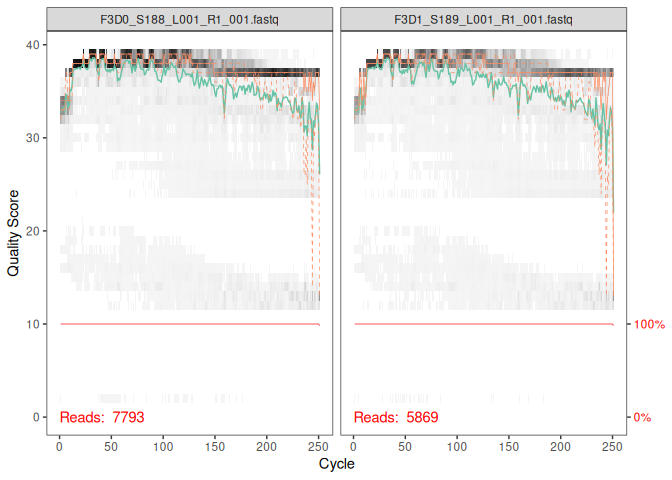
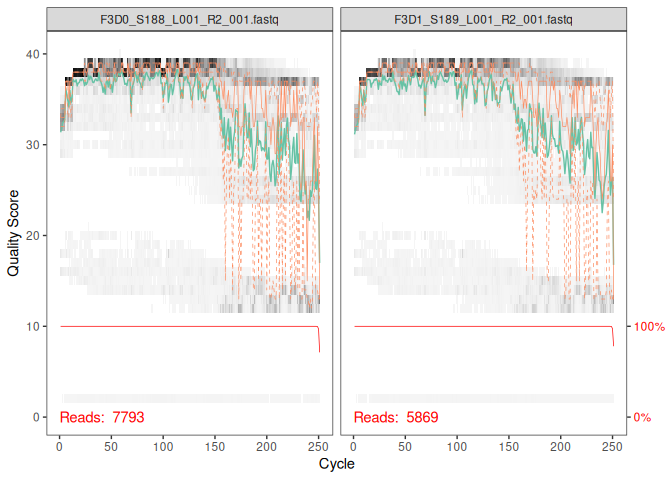
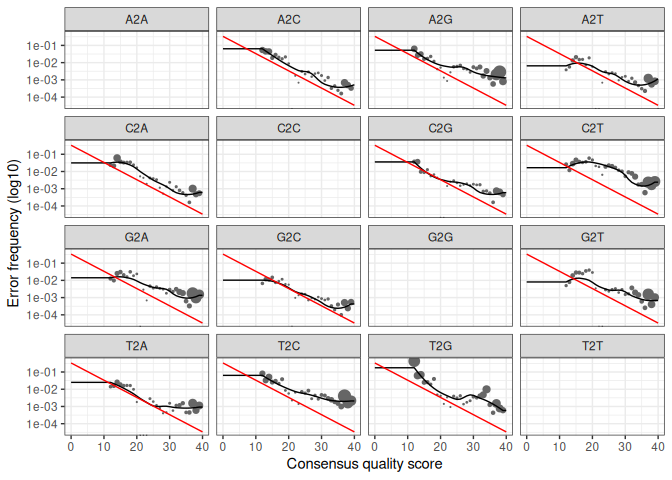
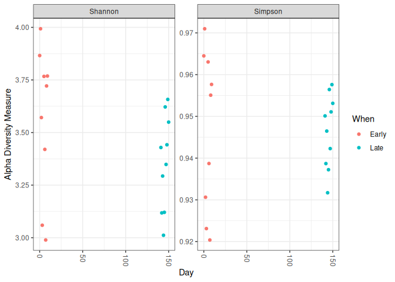
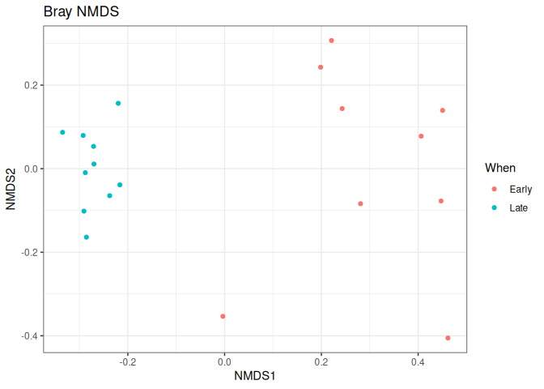
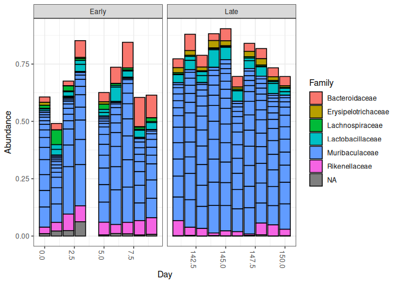

Tutoriel DADA2 et Phyloseq
================
Mehri Sana
Université Bretagne Occidentale ,Master MFA

Ce document suit le tutoriel DADA2 appliqué au jeu de données MiSeq SOP
(séquençage de l’ARNr 16S). Il va des lectures brutes (FASTQ) jusqu’à
l’analyse de la diversité microbienne avec phyloseq.

# 1. Préparation de l’environnement

## 1.1 Dans le terminal

Avant de commencer, on prépare le dossier de travail et on récupère les
données : le jeu d’exemple MiSeq SOP (fichiers FASTQ) et les bases de
données SILVA, qui serviront à identifier les bactéries (assignation
taxonomique).

``` bash
# 1. Se placer dans ton dossier de travail
cd /home/rstudio/ADMARTICLE/ADM_dada2tuto
# 2. Télécharger et décompresser les données FASTQ du tutoriel (MiSeq SOP)
# Télécharger et décompresser le jeu de données d'exemple MiSeq SOP
# 3. Télécharger les bases de données SILVA pour l'assignation taxonomique
```

## 1.2 Installation de dada2

On installe d’abord `BiocManager`, le gestionnaire qui permet
d’installer les packages du dépôt Bioconductor, puis le package `dada2`.

``` r
install.packages("BiocManager")
```

    ## Installing package into '/usr/local/lib/R/site-library'
    ## (as 'lib' is unspecified)

``` r
BiocManager::install("dada2", version = "3.23")
```

    ## 'getOption("repos")' replaces Bioconductor standard repositories, see
    ## 'help("repositories", package = "BiocManager")' for details.
    ## Replacement repositories:
    ##     CRAN: https://p3m.dev/cran/__linux__/noble/latest

    ## Bioconductor version 3.23 (BiocManager 1.30.27), R 4.6.1 (2026-06-24)

    ## Warning: package(s) not installed when version(s) same as or greater than current; use
    ##   `force = TRUE` to re-install: 'dada2'

    ## Installation paths not writeable, unable to update packages
    ##   path: /usr/local/lib/R/library
    ##   packages:
    ##     class, cluster, foreign, KernSmooth, lattice, MASS, Matrix, mgcv, nlme,
    ##     nnet, spatial, survival

    ## Old packages: 'gargle', 'googledrive', 'googlesheets4', 'openssl'

Seconde installation de `dada2` via Bioconductor. Cette étape n’est
utile que si le package n’est pas déjà installé.

``` r
BiocManager::install("dada2")
```

    ## 'getOption("repos")' replaces Bioconductor standard repositories, see
    ## 'help("repositories", package = "BiocManager")' for details.
    ## Replacement repositories:
    ##     CRAN: https://p3m.dev/cran/__linux__/noble/latest

    ## Bioconductor version 3.23 (BiocManager 1.30.27), R 4.6.1 (2026-06-24)

    ## Warning: package(s) not installed when version(s) same as or greater than current; use
    ##   `force = TRUE` to re-install: 'dada2'

    ## Installation paths not writeable, unable to update packages
    ##   path: /usr/local/lib/R/library
    ##   packages:
    ##     class, cluster, foreign, KernSmooth, lattice, MASS, Matrix, mgcv, nlme,
    ##     nnet, spatial, survival

    ## Old packages: 'gargle', 'googledrive', 'googlesheets4', 'openssl'

On charge `dada2` dans la session R, puis on affiche sa version, ce qui
permet de documenter l’analyse et de la rendre reproductible.

``` r
library(dada2)
```

    ## Loading required package: Rcpp

``` r
packageVersion("dada2")
```

    ## [1] '1.40.0'

# 2. Importation des données

On indique le dossier qui contient les fichiers FASTQ, puis on liste son
contenu pour vérifier que les fichiers sont bien présents.

``` r
path <- "/home/rstudio/ADMARTICLE/ADM_dada2tuto/MiSeq_SOP"
list.files(path)
```

    ##  [1] "F3D0_S188_L001_R1_001.fastq"   "F3D0_S188_L001_R2_001.fastq"  
    ##  [3] "F3D1_S189_L001_R1_001.fastq"   "F3D1_S189_L001_R2_001.fastq"  
    ##  [5] "F3D141_S207_L001_R1_001.fastq" "F3D141_S207_L001_R2_001.fastq"
    ##  [7] "F3D142_S208_L001_R1_001.fastq" "F3D142_S208_L001_R2_001.fastq"
    ##  [9] "F3D143_S209_L001_R1_001.fastq" "F3D143_S209_L001_R2_001.fastq"
    ## [11] "F3D144_S210_L001_R1_001.fastq" "F3D144_S210_L001_R2_001.fastq"
    ## [13] "F3D145_S211_L001_R1_001.fastq" "F3D145_S211_L001_R2_001.fastq"
    ## [15] "F3D146_S212_L001_R1_001.fastq" "F3D146_S212_L001_R2_001.fastq"
    ## [17] "F3D147_S213_L001_R1_001.fastq" "F3D147_S213_L001_R2_001.fastq"
    ## [19] "F3D148_S214_L001_R1_001.fastq" "F3D148_S214_L001_R2_001.fastq"
    ## [21] "F3D149_S215_L001_R1_001.fastq" "F3D149_S215_L001_R2_001.fastq"
    ## [23] "F3D150_S216_L001_R1_001.fastq" "F3D150_S216_L001_R2_001.fastq"
    ## [25] "F3D2_S190_L001_R1_001.fastq"   "F3D2_S190_L001_R2_001.fastq"  
    ## [27] "F3D3_S191_L001_R1_001.fastq"   "F3D3_S191_L001_R2_001.fastq"  
    ## [29] "F3D5_S193_L001_R1_001.fastq"   "F3D5_S193_L001_R2_001.fastq"  
    ## [31] "F3D6_S194_L001_R1_001.fastq"   "F3D6_S194_L001_R2_001.fastq"  
    ## [33] "F3D7_S195_L001_R1_001.fastq"   "F3D7_S195_L001_R2_001.fastq"  
    ## [35] "F3D8_S196_L001_R1_001.fastq"   "F3D8_S196_L001_R2_001.fastq"  
    ## [37] "F3D9_S197_L001_R1_001.fastq"   "F3D9_S197_L001_R2_001.fastq"  
    ## [39] "filtered"                      "HMP_MOCK.v35.fasta"           
    ## [41] "Mock_S280_L001_R1_001.fastq"   "Mock_S280_L001_R2_001.fastq"  
    ## [43] "mouse.dpw.metadata"            "mouse.time.design"            
    ## [45] "stability.batch"               "stability.files"

Le séquençage Illumina MiSeq produit deux fichiers par échantillon : un
pour les lectures Forward (R1) et un pour les lectures Reverse (R2). On
les récupère et on les trie dans le même ordre pour que chaque R1
corresponde à son R2. Le nom de chaque échantillon est extrait du nom de
fichier (partie avant le premier « \_ »).

``` r
fnFs <- sort(list.files(path, pattern="_R1_001.fastq", full.names = TRUE))
fnRs <- sort(list.files(path, pattern="_R2_001.fastq", full.names = TRUE))
sample.names <- sapply(strsplit(basename(fnFs), "_"), `[`, 1)
```

# 3. Contrôle qualité des lectures

On trace le profil de qualité des deux premiers échantillons, d’abord en
Forward (R1) puis en Reverse (R2). Ces graphiques montrent la qualité du
séquençage (score Phred) base par base. Elle baisse généralement en fin
de lecture, surtout pour les Reverse. Ils servent à choisir où tronquer
les lectures à l’étape suivante.

``` r
plotQualityProfile(fnFs[1:2])
```

<!-- -->

``` r
plotQualityProfile(fnRs[1:2])
```

<!-- -->

# 4. Filtrage et troncature

On définit les chemins des fichiers filtrés, qui seront créés dans un
sous-dossier `filtered`, et on donne aux vecteurs le nom des
échantillons.

``` r
filtFs <- file.path(path, "filtered", paste0(sample.names, "_F_filt.fastq.gz"))
filtRs <- file.path(path, "filtered", paste0(sample.names, "_R_filt.fastq.gz"))
names(filtFs) <- sample.names
names(filtRs) <- sample.names
```

On filtre et on tronque les lectures avec les paramètres suivants :

- `truncLen=c(240,160)` : coupe les lectures Forward à 240 pb et les
  Reverse à 160 pb, pour éliminer les extrémités de mauvaise qualité ;
- `maxN=0` : aucune base ambiguë (N) tolérée ;
- `maxEE=c(2,2)` : nombre maximal d’erreurs attendues toléré par lecture
  ;
- `truncQ=2` : coupe la lecture dès qu’une base a un score de qualité
  inférieur ou égal à 2 ;
- `rm.phix=TRUE` : retire les séquences du phage PhiX, ajouté comme
  contrôle lors du séquençage.

Le tableau affiché indique le nombre de séquences avant (`reads.in`) et
après (`reads.out`) filtrage.

``` r
out <- filterAndTrim(fnFs, filtFs, fnRs, filtRs, truncLen=c(240,160),
                      maxN=0, maxEE=c(2,2), truncQ=2, rm.phix=TRUE,
                      compress=TRUE, multithread=FALSE)
head(out)
```

    ##                               reads.in reads.out
    ## F3D0_S188_L001_R1_001.fastq       7793      7113
    ## F3D1_S189_L001_R1_001.fastq       5869      5299
    ## F3D141_S207_L001_R1_001.fastq     5958      5463
    ## F3D142_S208_L001_R1_001.fastq     3183      2914
    ## F3D143_S209_L001_R1_001.fastq     3178      2941
    ## F3D144_S210_L001_R1_001.fastq     4827      4312

# 5. Modèle d’erreur

DADA2 apprend le taux d’erreur de séquençage propre à ce jeu de données.
Il faut le faire séparément pour les lectures Forward, puis pour les
Reverse, car elles n’ont pas le même profil d’erreur.

``` r
errF <- learnErrors(filtFs, multithread=TRUE)
```

    ## 33514080 total bases in 139642 reads from 20 samples will be used for learning the error rates.

``` r
errR <- learnErrors(filtRs, multithread=TRUE)
```

    ## 22342720 total bases in 139642 reads from 20 samples will be used for learning the error rates.

On vérifie graphiquement la qualité du modèle (ici pour les Forward). La
ligne noire est le modèle estimé et les points sont les erreurs
observées. Le modèle est correct si les points suivent bien la ligne et
si le taux d’erreur diminue quand la qualité augmente.

``` r
plotErrors(errF, nominalQ=TRUE)
```

    ## Warning in scale_y_log10(): log-10 transformation introduced infinite values.

    ## Warning: Removed 164 rows containing missing values or values outside the scale range
    ## (`geom_line()`).
    ## Removed 164 rows containing missing values or values outside the scale range
    ## (`geom_line()`).

<!-- -->

# 6. Inférence des ASV

C’est l’étape centrale de DADA2. L’algorithme utilise le modèle d’erreur
pour corriger les erreurs de séquençage et déduire les vraies séquences
biologiques, appelées ASV (*Amplicon Sequence Variants*). On l’applique
d’abord aux lectures Forward.

``` r
dadaFs <- dada(filtFs, err=errF, multithread=TRUE)
```

    ## Sample 1 - 7113 reads in 1979 unique sequences.
    ## Sample 2 - 5299 reads in 1639 unique sequences.
    ## Sample 3 - 5463 reads in 1477 unique sequences.
    ## Sample 4 - 2914 reads in 904 unique sequences.
    ## Sample 5 - 2941 reads in 939 unique sequences.
    ## Sample 6 - 4312 reads in 1267 unique sequences.
    ## Sample 7 - 6741 reads in 1756 unique sequences.
    ## Sample 8 - 4560 reads in 1438 unique sequences.
    ## Sample 9 - 15637 reads in 3590 unique sequences.
    ## Sample 10 - 11413 reads in 2762 unique sequences.
    ## Sample 11 - 12017 reads in 3021 unique sequences.
    ## Sample 12 - 5032 reads in 1566 unique sequences.
    ## Sample 13 - 18075 reads in 3707 unique sequences.
    ## Sample 14 - 6250 reads in 1479 unique sequences.
    ## Sample 15 - 4052 reads in 1195 unique sequences.
    ## Sample 16 - 7369 reads in 1832 unique sequences.
    ## Sample 17 - 4765 reads in 1183 unique sequences.
    ## Sample 18 - 4871 reads in 1382 unique sequences.
    ## Sample 19 - 6504 reads in 1709 unique sequences.
    ## Sample 20 - 4314 reads in 897 unique sequences.

Même opération pour les lectures Reverse.

``` r
dadaRs <- dada(filtRs, err=errR, multithread=TRUE)
```

    ## Sample 1 - 7113 reads in 1660 unique sequences.
    ## Sample 2 - 5299 reads in 1349 unique sequences.
    ## Sample 3 - 5463 reads in 1335 unique sequences.
    ## Sample 4 - 2914 reads in 853 unique sequences.
    ## Sample 5 - 2941 reads in 880 unique sequences.
    ## Sample 6 - 4312 reads in 1286 unique sequences.
    ## Sample 7 - 6741 reads in 1803 unique sequences.
    ## Sample 8 - 4560 reads in 1265 unique sequences.
    ## Sample 9 - 15637 reads in 3414 unique sequences.
    ## Sample 10 - 11413 reads in 2522 unique sequences.
    ## Sample 11 - 12017 reads in 2771 unique sequences.
    ## Sample 12 - 5032 reads in 1415 unique sequences.
    ## Sample 13 - 18075 reads in 3290 unique sequences.
    ## Sample 14 - 6250 reads in 1390 unique sequences.
    ## Sample 15 - 4052 reads in 1134 unique sequences.
    ## Sample 16 - 7369 reads in 1635 unique sequences.
    ## Sample 17 - 4765 reads in 1084 unique sequences.
    ## Sample 18 - 4871 reads in 1161 unique sequences.
    ## Sample 19 - 6504 reads in 1502 unique sequences.
    ## Sample 20 - 4314 reads in 732 unique sequences.

On inspecte le résultat pour le premier échantillon : le nombre de
variantes de séquences réelles trouvées parmi les séquences uniques
analysées.

``` r
dadaFs[[1]]
```

    ## dada-class: object describing DADA2 denoising results
    ## 128 sequence variants were inferred from 1979 input unique sequences.
    ## Key parameters: OMEGA_A = 1e-40, OMEGA_C = 1e-40, BAND_SIZE = 16

# 7. Fusion des lectures et table d’ASV

On fusionne chaque lecture Forward avec son Reverse pour reconstituer
l’amplicon complet. Seules les paires qui se chevauchent correctement
sont conservées. On affiche les premières séquences fusionnées du
premier échantillon.

``` r
mergers <- mergePairs(dadaFs, filtFs, dadaRs, filtRs, verbose=TRUE)
```

    ## 6540 paired-reads (in 107 unique pairings) successfully merged out of 6891 (in 197 pairings) input.

    ## 5028 paired-reads (in 101 unique pairings) successfully merged out of 5190 (in 157 pairings) input.

    ## 4986 paired-reads (in 81 unique pairings) successfully merged out of 5267 (in 166 pairings) input.

    ## 2595 paired-reads (in 52 unique pairings) successfully merged out of 2754 (in 108 pairings) input.

    ## 2553 paired-reads (in 60 unique pairings) successfully merged out of 2785 (in 119 pairings) input.

    ## 3646 paired-reads (in 55 unique pairings) successfully merged out of 4109 (in 157 pairings) input.

    ## 6079 paired-reads (in 81 unique pairings) successfully merged out of 6514 (in 198 pairings) input.

    ## 3968 paired-reads (in 91 unique pairings) successfully merged out of 4388 (in 187 pairings) input.

    ## 14233 paired-reads (in 143 unique pairings) successfully merged out of 15355 (in 352 pairings) input.

    ## 10528 paired-reads (in 120 unique pairings) successfully merged out of 11165 (in 278 pairings) input.

    ## 11154 paired-reads (in 137 unique pairings) successfully merged out of 11797 (in 298 pairings) input.

    ## 4349 paired-reads (in 85 unique pairings) successfully merged out of 4802 (in 179 pairings) input.

    ## 17431 paired-reads (in 153 unique pairings) successfully merged out of 17812 (in 272 pairings) input.

    ## 5850 paired-reads (in 81 unique pairings) successfully merged out of 6095 (in 159 pairings) input.

    ## 3716 paired-reads (in 86 unique pairings) successfully merged out of 3894 (in 147 pairings) input.

    ## 6865 paired-reads (in 99 unique pairings) successfully merged out of 7191 (in 187 pairings) input.

    ## 4426 paired-reads (in 67 unique pairings) successfully merged out of 4603 (in 127 pairings) input.

    ## 4576 paired-reads (in 101 unique pairings) successfully merged out of 4739 (in 174 pairings) input.

    ## 6092 paired-reads (in 109 unique pairings) successfully merged out of 6315 (in 173 pairings) input.

    ## 4269 paired-reads (in 20 unique pairings) successfully merged out of 4281 (in 28 pairings) input.

``` r
head(mergers[[1]])
```

    ##                                                                                                                                                                                                                                                       sequence
    ## 1 TACGGAGGATGCGAGCGTTATCCGGATTTATTGGGTTTAAAGGGTGCGCAGGCGGAAGATCAAGTCAGCGGTAAAATTGAGAGGCTCAACCTCTTCGAGCCGTTGAAACTGGTTTTCTTGAGTGAGCGAGAAGTATGCGGAATGCGTGGTGTAGCGGTGAAATGCATAGATATCACGCAGAACTCCGATTGCGAAGGCAGCATACCGGCGCTCAACTGACGCTCATGCACGAAAGTGTGGGTATCGAACAGG
    ## 2 TACGGAGGATGCGAGCGTTATCCGGATTTATTGGGTTTAAAGGGTGCGTAGGCGGCCTGCCAAGTCAGCGGTAAAATTGCGGGGCTCAACCCCGTACAGCCGTTGAAACTGCCGGGCTCGAGTGGGCGAGAAGTATGCGGAATGCGTGGTGTAGCGGTGAAATGCATAGATATCACGCAGAACCCCGATTGCGAAGGCAGCATACCGGCGCCCTACTGACGCTGAGGCACGAAAGTGCGGGGATCAAACAGG
    ## 3 TACGGAGGATGCGAGCGTTATCCGGATTTATTGGGTTTAAAGGGTGCGTAGGCGGGCTGTTAAGTCAGCGGTCAAATGTCGGGGCTCAACCCCGGCCTGCCGTTGAAACTGGCGGCCTCGAGTGGGCGAGAAGTATGCGGAATGCGTGGTGTAGCGGTGAAATGCATAGATATCACGCAGAACTCCGATTGCGAAGGCAGCATACCGGCGCCCGACTGACGCTGAGGCACGAAAGCGTGGGTATCGAACAGG
    ## 4 TACGGAGGATGCGAGCGTTATCCGGATTTATTGGGTTTAAAGGGTGCGTAGGCGGGCTTTTAAGTCAGCGGTAAAAATTCGGGGCTCAACCCCGTCCGGCCGTTGAAACTGGGGGCCTTGAGTGGGCGAGAAGAAGGCGGAATGCGTGGTGTAGCGGTGAAATGCATAGATATCACGCAGAACCCCGATTGCGAAGGCAGCCTTCCGGCGCCCTACTGACGCTGAGGCACGAAAGTGCGGGGATCGAACAGG
    ## 5 TACGGAGGATGCGAGCGTTATCCGGATTTATTGGGTTTAAAGGGTGCGCAGGCGGACTCTCAAGTCAGCGGTCAAATCGCGGGGCTCAACCCCGTTCCGCCGTTGAAACTGGGAGCCTTGAGTGCGCGAGAAGTAGGCGGAATGCGTGGTGTAGCGGTGAAATGCATAGATATCACGCAGAACTCCGATTGCGAAGGCAGCCTACCGGCGCGCAACTGACGCTCATGCACGAAAGCGTGGGTATCGAACAGG
    ## 6 TACGGAGGATGCGAGCGTTATCCGGATTTATTGGGTTTAAAGGGTGCGTAGGCGGGATGCCAAGTCAGCGGTAAAAAAGCGGTGCTCAACGCCGTCGAGCCGTTGAAACTGGCGTTCTTGAGTGGGCGAGAAGTATGCGGAATGCGTGGTGTAGCGGTGAAATGCATAGATATCACGCAGAACTCCGATTGCGAAGGCAGCATACCGGCGCCCTACTGACGCTGAGGCACGAAAGCGTGGGTATCGAACAGG
    ##   abundance forward reverse nmatch nmismatch nindel prefer accept
    ## 1       579       1       1    148         0      0      1   TRUE
    ## 2       470       2       2    148         0      0      2   TRUE
    ## 3       449       3       4    148         0      0      1   TRUE
    ## 4       430       4       3    148         0      0      2   TRUE
    ## 5       345       5       6    148         0      0      1   TRUE
    ## 6       282       6       5    148         0      0      2   TRUE

On construit la table d’abondance des ASV : une ligne par échantillon,
une colonne par ASV, et dans chaque case le nombre de lectures. `dim()`
donne ses dimensions (nombre d’échantillons × nombre d’ASV).

``` r
seqtab <- makeSequenceTable(mergers)
dim(seqtab)
```

    ## [1]  20 293

On regarde la distribution des longueurs des amplicons obtenus. Elle
doit se concentrer autour de la taille attendue de la région amplifiée.
Les longueurs très éloignées peuvent être des artefacts.

``` r
table(nchar(getSequences(seqtab)))
```

    ## 
    ## 251 252 253 254 255 
    ##   1  88 196   6   2

# 8. Retrait des chimères

Les chimères sont des séquences artificielles formées lors de la PCR,
quand deux séquences différentes se recollent. On les détecte et on les
retire avec `removeBimeraDenovo`. Odim(seqtab.nochim)

# 8.1Afficher les dimensions de la table après retrait des chimères

``` r
seqtab.nochim <- removeBimeraDenovo(seqtab, method="consensus", multithread=TRUE, verbose=TRUE)
```

    ## Identified 61 bimeras out of 293 input sequences.

``` r
dim(seqtab.nochim)
```

    ## [1]  20 232

On calcule la proportion de lectures conservées après ce retrait. Elle
doit rester proche de 1 : même si beaucoup d’ASV sont des chimères,
elles représentent peu de lectures.

``` r
sum(seqtab.nochim)/sum(seqtab)
```

    ## [1] 0.9640374

# 9. Suivi des lectures à chaque étape

On construit un tableau de suivi qui indique combien de lectures restent
après chaque étape du pipeline : entrée, filtrage, débruitage Forward et
Reverse, fusion, retrait des chimères. Il sert à repérer une étape où
l’on perd trop de lectures.

``` r
getN <- function(x) sum(getUniques(x))
track <- cbind(out, sapply(dadaFs, getN), sapply(dadaRs, getN), sapply(mergers, getN), rowSums(seqtab.nochim))
colnames(track) <- c("input", "filtered", "denoisedF", "denoisedR", "merged", "nonchim")
rownames(track) <- sample.names
head(track)
```

    ##        input filtered denoisedF denoisedR merged nonchim
    ## F3D0    7793     7113      6976      6979   6540    6528
    ## F3D1    5869     5299      5227      5239   5028    5017
    ## F3D141  5958     5463      5331      5357   4986    4863
    ## F3D142  3183     2914      2799      2830   2595    2521
    ## F3D143  3178     2941      2822      2868   2553    2519
    ## F3D144  4827     4312      4151      4228   3646    3507

# 10. Assignation taxonomique

On compare chaque ASV à la base de référence SILVA v138.2 pour
identifier les bactéries, jusqu’au niveau du genre.

``` r
taxa <- assignTaxonomy(seqtab.nochim,"/home/rstudio/ADMARTICLE/ADM_dada2tuto/silva_nr99_v138.2_toGenus_trainset.fa.gz", multithread=TRUE)
```

On ajoute l’assignation au niveau de l’espèce, quand la correspondance
avec la référence est exacte.

``` r
taxa <- addSpecies(taxa, "/home/rstudio/ADMARTICLE/ADM_dada2tuto/silva_v138.2_assignSpecies.fa.gz")
```

Pour l’affichage, on retire les séquences brutes qui servent de noms de
lignes (elles sont très longues) et on montre les premières lignes de la
table taxonomique.

``` r
taxa.print <- taxa 
rownames(taxa.print) <- NULL
head(taxa.print)
```

    ##      Kingdom    Phylum         Class         Order           Family          
    ## [1,] "Bacteria" "Bacteroidota" "Bacteroidia" "Bacteroidales" "Muribaculaceae"
    ## [2,] "Bacteria" "Bacteroidota" "Bacteroidia" "Bacteroidales" "Muribaculaceae"
    ## [3,] "Bacteria" "Bacteroidota" "Bacteroidia" "Bacteroidales" "Muribaculaceae"
    ## [4,] "Bacteria" "Bacteroidota" "Bacteroidia" "Bacteroidales" "Muribaculaceae"
    ## [5,] "Bacteria" "Bacteroidota" "Bacteroidia" "Bacteroidales" "Bacteroidaceae"
    ## [6,] "Bacteria" "Bacteroidota" "Bacteroidia" "Bacteroidales" "Muribaculaceae"
    ##      Genus         Species
    ## [1,] NA            NA     
    ## [2,] NA            NA     
    ## [3,] NA            NA     
    ## [4,] NA            NA     
    ## [5,] "Bacteroides" NA     
    ## [6,] NA            NA

# 11. Évaluation de la précision avec la communauté Mock

L’échantillon « Mock » est une communauté artificielle dont la
composition est connue. Il permet de vérifier que le pipeline retrouve
bien les bonnes séquences.

On installe puis on charge le package `DECIPHER`.

``` r
if (!requireNamespace("BiocManager", quietly=TRUE))
    install.packages("BiocManager")
BiocManager::install("DECIPHER")
```

    ## 'getOption("repos")' replaces Bioconductor standard repositories, see
    ## 'help("repositories", package = "BiocManager")' for details.
    ## Replacement repositories:
    ##     CRAN: https://p3m.dev/cran/__linux__/noble/latest

    ## Bioconductor version 3.23 (BiocManager 1.30.27), R 4.6.1 (2026-06-24)

    ## Warning: package(s) not installed when version(s) same as or greater than current; use
    ##   `force = TRUE` to re-install: 'DECIPHER'

    ## Installation paths not writeable, unable to update packages
    ##   path: /usr/local/lib/R/library
    ##   packages:
    ##     class, cluster, foreign, KernSmooth, lattice, MASS, Matrix, mgcv, nlme,
    ##     nnet, spatial, survival

    ## Old packages: 'gargle', 'googledrive', 'googlesheets4', 'openssl'

``` r
library(DECIPHER); packageVersion("DECIPHER")
```

    ## Loading required package: Biostrings

    ## Loading required package: BiocGenerics

    ## Loading required package: generics

    ## 
    ## Attaching package: 'generics'

    ## The following objects are masked from 'package:base':
    ## 
    ##     as.difftime, as.factor, as.ordered, intersect, is.element, setdiff,
    ##     setequal, union

    ## 
    ## Attaching package: 'BiocGenerics'

    ## The following objects are masked from 'package:stats':
    ## 
    ##     IQR, mad, sd, var, xtabs

    ## The following objects are masked from 'package:base':
    ## 
    ##     anyDuplicated, aperm, append, as.data.frame, basename, cbind,
    ##     colnames, dirname, do.call, duplicated, eval, evalq, Filter, Find,
    ##     get, grep, grepl, is.unsorted, lapply, Map, mapply, match, mget,
    ##     order, paste, pmax, pmax.int, pmin, pmin.int, Position, rank,
    ##     rbind, Reduce, rownames, sapply, saveRDS, table, tapply, unique,
    ##     unsplit, which.max, which.min

    ## Loading required package: S4Vectors

    ## Loading required package: stats4

    ## 
    ## Attaching package: 'S4Vectors'

    ## The following object is masked from 'package:utils':
    ## 
    ##     findMatches

    ## The following objects are masked from 'package:base':
    ## 
    ##     expand.grid, I, unname

    ## Loading required package: IRanges

    ## Loading required package: XVector

    ## Loading required package: Seqinfo

    ## 
    ## Attaching package: 'Biostrings'

    ## The following object is masked from 'package:base':
    ## 
    ##     strsplit

    ## [1] '3.8.1'

On extrait les séquences trouvées dans le Mock en gardant uniquement les
ASV présentes (abondance \> 0), classées de la plus à la moins
abondante.

``` r
unqs.mock <- seqtab.nochim["Mock",]
unqs.mock <- sort(unqs.mock[unqs.mock>0], decreasing=TRUE) # Drop ASVs absent in the Mock
cat("DADA2 inferred", length(unqs.mock), "sample sequences present in the Mock community.\n")
```

    ## DADA2 inferred 20 sample sequences present in the Mock community.

On charge les séquences de référence du Mock (fichier FASTA) et on
compte combien d’ASV trouvées correspondent exactement aux séquences
attendues. Plus ce nombre est proche du nombre d’ASV, plus le pipeline
est précis.

``` r
mock.ref <- getSequences(file.path(path, "HMP_MOCK.v35.fasta"))
match.ref <- sum(sapply(names(unqs.mock), function(x) any(grepl(x, mock.ref))))
cat("Of those,", sum(match.ref), "were exact matches to the expected reference sequences.\n")
```

    ## Of those, 20 were exact matches to the expected reference sequences.

# 12. Analyse avec phyloseq

## 12.1 Installation et chargement des packages

On installe `igraph` et `phyloseq`, utilisés pour l’analyse écologique
et les graphiques.

``` r
if (!requireNamespace("BiocManager", quietly = TRUE))
    install.packages("BiocManager")

install.packages("igraph")
```

    ## Installing package into '/usr/local/lib/R/site-library'
    ## (as 'lib' is unspecified)

``` r
BiocManager::install("phyloseq")
```

    ## 'getOption("repos")' replaces Bioconductor standard repositories, see
    ## 'help("repositories", package = "BiocManager")' for details.
    ## Replacement repositories:
    ##     CRAN: https://p3m.dev/cran/__linux__/noble/latest

    ## Bioconductor version 3.23 (BiocManager 1.30.27), R 4.6.1 (2026-06-24)

    ## Warning: package(s) not installed when version(s) same as or greater than current; use
    ##   `force = TRUE` to re-install: 'phyloseq'

    ## Installation paths not writeable, unable to update packages
    ##   path: /usr/local/lib/R/library
    ##   packages:
    ##     class, cluster, foreign, KernSmooth, lattice, MASS, Matrix, mgcv, nlme,
    ##     nnet, spatial, survival

    ## Old packages: 'gargle', 'googledrive', 'googlesheets4', 'openssl'

On charge les bibliothèques nécessaires : `phyloseq` pour l’analyse,
`Biostrings` pour manipuler les séquences, `ggplot2` pour les
graphiques. On affiche leur version.

``` r
library(phyloseq)
```

    ## 
    ## Attaching package: 'phyloseq'

    ## The following object is masked from 'package:IRanges':
    ## 
    ##     distance

``` r
library(Biostrings); packageVersion("Biostrings")
```

    ## [1] '2.80.2'

``` r
library(phyloseq); packageVersion("phyloseq")
```

    ## [1] '1.56.0'

``` r
library(ggplot2); packageVersion("ggplot2")
```

    ## [1] '4.0.3'

On définit un thème graphique par défaut pour tous les graphiques
ggplot2 (fond blanc, cadre noir).

``` r
theme_set(theme_bw())
```

## 12.2 Table des métadonnées

Les informations sur les échantillons se trouvent dans leur nom. Par
exemple `F3D141` correspond au sujet F3 (F pour Female, sujet n°3),
prélevé au jour 141. On les extrait pour construire une table de
métadonnées, et on crée une variable `When` qui sépare les prélèvements
précoces (Early, jour ≤ 100) des tardifs (Late, jour \> 100).

``` r
samples.out <- rownames(seqtab.nochim)
subject <- sapply(strsplit(samples.out, "D"), `[`, 1)
gender <- substr(subject,1,1)
subject <- substr(subject,2,999)
day <- as.integer(sapply(strsplit(samples.out, "D"), `[`, 2))
samdf <- data.frame(Subject=subject, Gender=gender, Day=day)
samdf$When <- "Early"
samdf$When[samdf$Day>100] <- "Late"
rownames(samdf) <- samples.out
```

## 12.3 Création de l’objet phyloseq

On assemble en un seul objet `phyloseq` la table d’ASV, les métadonnées
et la taxonomie. On retire ensuite l’échantillon Mock, qui n’est pas un
vrai échantillon biologique.

``` r
ps <- phyloseq(otu_table(seqtab.nochim, taxa_are_rows=FALSE),
               sample_data(samdf),
               tax_table(taxa))
ps <- prune_samples(sample_names(ps) != "Mock", ps) # Remove mock sample
```

On stocke les séquences des ASV dans l’objet, puis on remplace leurs
longs noms (la séquence complète) par des identifiants courts (ASV1,
ASV2, etc.). On affiche enfin le résumé de l’objet.

``` r
dna <- Biostrings::DNAStringSet(taxa_names(ps))
names(dna) <- taxa_names(ps)
ps <- merge_phyloseq(ps, dna)
taxa_names(ps) <- paste0("ASV", seq(ntaxa(ps)))
ps
```

    ## phyloseq-class experiment-level object
    ## otu_table()   OTU Table:         [ 232 taxa and 19 samples ]
    ## sample_data() Sample Data:       [ 19 samples by 4 sample variables ]
    ## tax_table()   Taxonomy Table:    [ 232 taxa by 7 taxonomic ranks ]
    ## refseq()      DNAStringSet:      [ 232 reference sequences ]

## 12.4 Diversité alpha

La diversité alpha mesure la diversité au sein de chaque échantillon. On
trace les indices de Shannon et de Simpson en fonction du jour de
prélèvement, colorés selon la période (Early/Late) pour voir si la
diversité change dans le temps.

``` r
plot_richness(ps, x="Day", measures=c("Shannon", "Simpson"), color="When")
```

    ## Warning in estimate_richness(physeq, split = TRUE, measures = measures): The data you have provided does not have
    ## any singletons. This is highly suspicious. Results of richness
    ## estimates (for example) are probably unreliable, or wrong, if you have already
    ## trimmed low-abundance taxa from the data.
    ## 
    ## We recommended that you find the un-trimmed data and retry.

    ## Warning: `aes_string()` was deprecated in ggplot2 3.0.0.
    ## ℹ Please use tidy evaluation idioms with `aes()`.
    ## ℹ See also `vignette("ggplot2-in-packages")` for more information.
    ## ℹ The deprecated feature was likely used in the phyloseq package.
    ##   Please report the issue at <https://github.com/joey711/phyloseq/issues>.
    ## This warning is displayed once per session.
    ## Call `lifecycle::last_lifecycle_warnings()` to see where this warning was
    ## generated.

<!-- -->

## 12.5 Diversité beta

La diversité beta compare les échantillons entre eux. On convertit
d’abord les comptages en abondances relatives (proportions) pour pouvoir
comparer des échantillons séquencés à des profondeurs différentes. On
calcule ensuite la distance de Bray-Curtis entre échantillons et on les
représente en 2D par une ordination NMDS.

``` r
ps.prop <- transform_sample_counts(ps, function(otu) otu/sum(otu))
ord.nmds.bray <- ordinate(ps.prop, method="NMDS", distance="bray")
```

    ## Run 0 stress 0.08043117 
    ## Run 1 stress 0.08616061 
    ## Run 2 stress 0.08043117 
    ## ... New best solution
    ## ... Procrustes: rmse 7.958275e-07  max resid 1.829642e-06 
    ## ... Similar to previous best
    ## Run 3 stress 0.08616061 
    ## Run 4 stress 0.08076336 
    ## ... Procrustes: rmse 0.01049075  max resid 0.0322846 
    ## Run 5 stress 0.09477207 
    ## Run 6 stress 0.08616061 
    ## Run 7 stress 0.08616061 
    ## Run 8 stress 0.1212044 
    ## Run 9 stress 0.09477216 
    ## Run 10 stress 0.0807634 
    ## ... Procrustes: rmse 0.01056036  max resid 0.03251142 
    ## Run 11 stress 0.09477191 
    ## Run 12 stress 0.1358137 
    ## Run 13 stress 0.09477196 
    ## Run 14 stress 0.08616061 
    ## Run 15 stress 0.08076337 
    ## ... Procrustes: rmse 0.0105125  max resid 0.03235548 
    ## Run 16 stress 0.0947718 
    ## Run 17 stress 0.08043117 
    ## ... New best solution
    ## ... Procrustes: rmse 2.646021e-06  max resid 6.663804e-06 
    ## ... Similar to previous best
    ## Run 18 stress 0.08616061 
    ## Run 19 stress 0.08616061 
    ## Run 20 stress 0.08043117 
    ## ... Procrustes: rmse 2.96218e-06  max resid 8.037228e-06 
    ## ... Similar to previous best
    ## *** Best solution repeated 2 times

On affiche l’ordination, colorée par période. Deux points proches ont
des communautés bactériennes similaires. Si les couleurs forment des
groupes séparés, la composition varie entre le début et la fin.

``` r
plot_ordination(ps.prop, ord.nmds.bray, color="When", title="Bray NMDS")
```

<!-- -->

## 12.6 Composition taxonomique

On sélectionne les 20 ASV les plus abondantes dans l’ensemble des
échantillons, on les convertit en abondances relatives, puis on trace un
diagramme en barres. Les barres sont colorées par famille bactérienne et
séparées entre période précoce et tardive, pour voir comment la
composition du microbiote évolue.

``` r
top20 <- names(sort(taxa_sums(ps), decreasing=TRUE))[1:20]
ps.top20 <- transform_sample_counts(ps, function(OTU) OTU/sum(OTU))
ps.top20 <- prune_taxa(top20, ps.top20)
plot_bar(ps.top20, x="Day", fill="Family") + facet_wrap(~When, scales="free_x")
```

<!-- -->
